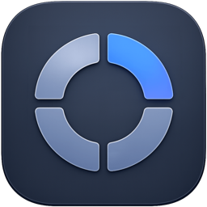
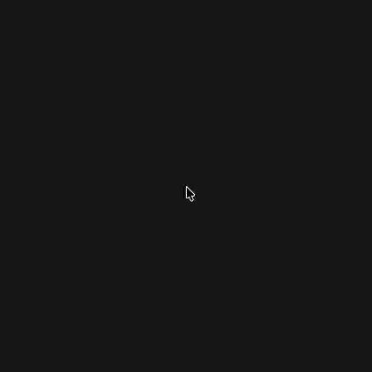

<p align="center">
  
</p>

<h1 align="center">PopDeck</h1>

<p align="center">
  <a href="https://popdeck.pages.dev/">Website</a> | <a href="README.md">English</a> | <a href="README.zh-CN.md">中文</a>
</p>

PopDeck is a native macOS pop-up launcher built with SwiftUI and AppKit. It lives in the menu bar and opens a cursor-centered launcher for frequently used apps, folders, and web links.

The project is currently in early development. The first goal is a lightweight, open-source macOS utility with a clean local configuration model and a release path that can later support automatic updates.

## Preview



## Features

- Menu bar app with no Dock icon.
- Global launcher shortcut, configurable from Settings.
- Cursor-centered launcher panel with draggable items.
- Default actions for common apps and folders.
- Add custom apps, folders, files, URLs, and shell commands.
- Restore the default launcher layout with one click.
- Optional launch at login.
- Chinese and English interface strings.

## Command Shortcuts

Choose **Add Command** in settings, enter an optional name and shell source, then add it to the panel. Commands run in the background using `/bin/zsh -lc`, starting in your home directory and loading zsh login configuration. Use `cd` or absolute paths as needed. Multiline commands, quoting, pipes and redirection are supported. Failures show the exit status and stderr.

No terminal opens; stdin and stdout use the null device. Redirect output to a file when needed. Use Terminal for interactive commands. Commands share the eight-item limit and can be reordered or removed in the preview.

The circular panel uses native Liquid Glass on macOS 26 and later, with the existing frosted material on older systems. Choose Regular for adaptive background blur and readability, or Clear for more transparency and edge refraction. Both use the native material without a custom tint. macOS appearance and accessibility settings can affect the result; there is no app-level blur-radius slider.

## Requirements

- macOS 14 or later.
- Xcode 26 or later (with the Liquid Glass SDK), or the matching Swift toolchain.

## Run From Source

```bash
./scripts/run-app.sh
```

In Xcode, open this folder as a Swift package, select the `PopDeck` executable, and run it.

Sparkle automatic update checks require the packaged `.app` bundle. To test update checks during development, use:

```bash
./scripts/run-app.sh
```

## Build The App Bundle

```bash
./scripts/build-app.sh release
```

The app bundle is created at:

```text
.build/PopDeck.app
```

## Create A DMG

```bash
./scripts/package-dmg.sh
```

The DMG is the public GitHub Release asset and the Sparkle update archive:

```text
dist/PopDeck-0.1.8.dmg
dist/PopDeck-0.1.8.dmg.sha256
```

## Install And Open

1. Download `PopDeck-0.1.8.dmg` from GitHub Releases.
2. Open the DMG and drag `PopDeck.app` to the Applications folder.
3. Open PopDeck.

Current release builds are unsigned. If macOS blocks the app, use one of these methods:

- Control-click `PopDeck.app`, choose Open, then choose Open again in the confirmation dialog.
- Or open System Settings, go to Privacy & Security, find the blocked PopDeck message, and choose Open Anyway.

Developer ID signing and notarization are planned for a future release.

## Project Identity

- App name: `PopDeck`
- Bundle identifier: `com.tangfanx.popdeck`
- Current version: `0.1.8`
- Current build: `9`

## Roadmap

- GitHub Releases for the first public downloads.
- Sparkle-based automatic updates.
- Developer ID signing and notarization.
- Optional Cloudflare-hosted update feed and release artifacts.

## License

PopDeck is released under the MIT License. See [LICENSE](LICENSE).
